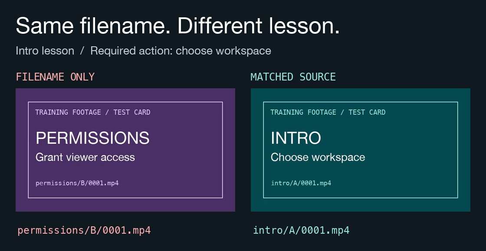

# Send footage to a video editor when two camera cards use the same filename

Keep the camera-card folders intact and give your editor a source manifest. Each row should identify the lesson or project, the file's path from the delivery root and a SHA-256 fingerprint. Use the path to find the intended clip and the fingerprint to confirm that it is the exact copy you approved for editing. If two clips look similar, the brief should also name one thing the reviewer can see or hear in the intended take.

This matters for recurring videos recorded by several people. An editor can open a valid MP4 that contains the wrong lesson, camera angle or permission level. That error can survive a check of the format, duration and filename.

## A two-clip test

[Download the sample footage and manifest](examples/editor-source-handoff/sample-footage.zip). The ZIP has two synthetic training clips, both called `0001.mp4` and both two seconds long. The intro should show “Choose workspace.” The other clip says “Grant viewer access.”



In this test, both files were indexed by filename, with the permissions clip entered second. The second entry replaced the first, so requesting `0001.mp4` returned the permissions clip. Looking up the intro's complete relative path returned the expected frame. Both results came from decoded MP4s. The test demonstrates an ingest failure your team can reproduce with any editor or service.

| Lesson | Manifest path | What to verify in the clip |
| --- | --- | --- |
| Intro | `intro/A/0001.mp4` | The action is “Choose workspace.” |
| Permissions | `permissions/B/0001.mp4` | The action is “Grant viewer access.” |

### Check the file you received

Unzip the sample into a clean directory. From inside it, run the following on macOS. On Linux, use `sha256sum` in place of `shasum -a 256`.

```sh
shasum -a 256 intro/A/0001.mp4 permissions/B/0001.mp4
```

Compare each result with the corresponding `relative_path` row in [the manifest](examples/editor-source-handoff/source-manifest.csv). As a second check, make a separate `rejected` folder and copy the permissions file into it as `0001.mp4`. Its fingerprint still matches the permissions row, even though it has the same name as the intro. A proxy or transcode intentionally has different bytes. In that case, preserve a mapping from the proxy to the original and verify the final edit's source after relinking. Adobe documents how [media relinking uses a combination of properties to identify the intended file](https://helpx.adobe.com/ca/premiere/desktop/organize-media/file-organization/locate-and-link-offline-files.html).

## Run a paid pilot before handing over a full batch

Give the editor two representative videos, using test footage or footage you can share. Include one pair of clips with the same camera filename and one version of a clip that looks almost identical but shows a different action. Also send the mic recording and label which lesson it belongs to, if it was recorded separately. Make the expected source path, visible action, intended mic and one requested edit explicit in your brief.

| What to request | What to check before approving |
| --- | --- |
| A mapping from lesson ID to source clip | Both repeated filenames appear with their own folder paths and the expected source fingerprints. |
| One review cut per lesson | The expected action is visible and the chosen mic belongs to the lesson. |
| One picture revision in the first lesson | The editor identifies the replacement source and returns a clearly labeled revision. The second lesson still uses its approved source. |
| A schedule for the monthly batch | The estimate includes collecting files, resolving ambiguous sources, review time and revisions. |

A brief you can copy:

> Edit two short training videos for our first batch. Preserve the supplied folder structure. For the intro, use `intro/A/0001.mp4` and keep the moment the speaker chooses a workspace. For permissions, use `permissions/B/0001.mp4` and keep the moment the viewer role is granted. Include the source path used in each review note. We will check both visible actions before approving one revision and confirming monthly volume.

Use the [approved MP4 and caption handoff check](VERIFY-TRAINING-VIDEO-HANDOFF.md) after sign-off. That step verifies the delivery files your learner will receive.

If your team records the lessons and wants someone to edit them each month, [scope a two-lesson pilot with Valmera Enterprise](https://valmera.io/subscribe?inquiry=training-video-editing-service&utm_source=github.com&utm_medium=referral&utm_campaign=source_handoff#enterprise). Include monthly volume, footage length, the expected turnaround and whether you need separate caption files. For a single edit you want to direct yourself, [open Valmera's AI video editor for existing footage](https://valmera.io/ai-video-editor?utm_source=github.com&utm_medium=referral&utm_campaign=source_handoff) and describe the result you want from the selected source clip.
