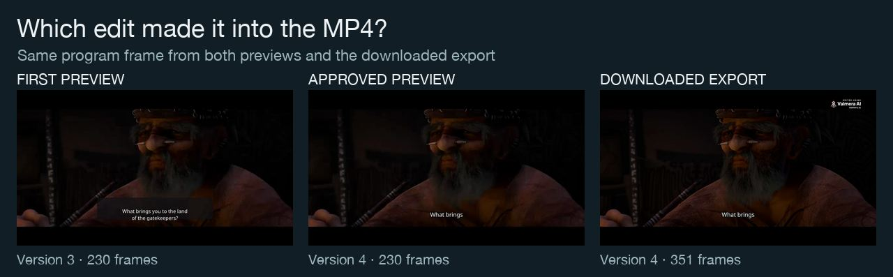

# Vidova vs. Valmera for editing existing footage with AI

Both editors let you describe an edit to footage you already recorded and download an MP4. Start with where the footage lives. Vidova documents a ChatGPT plugin that takes clips attached in the conversation. Valmera documents a connection to a project you upload in Studio and an export request that specifies the exact edit version. Before you subscribe to either, try one small revision and find out whether you can identify the approved version in the file you deliver.

## Which workflow fits your footage?

| Buying decision | Vidova | Valmera |
| --- | --- | --- |
| Start from a recording in ChatGPT | The published plugin workflow accepts video attachments up to 512 MB each or a file link. Check plugin availability in your account. [Vidova's plugin guide](https://www.vidova.ai/chatgpt) | Upload to Valmera Studio, then open that project through the custom MCP connection. You can also work directly in Studio. [Valmera's upload and connection guide](https://valmera.io/mcp/chatgpt#get-your-footage-into-valmera) |
| Review and change the edit | Vidova describes editing its saved timeline manually or with the agent, and provides a cloud export workflow. [Vidova documentation](https://vidova.ai/docs/introduction) | Review a preview and ask for a targeted revision in Studio or through a connected assistant. [Valmera's recorded revision](CAPTION-STYLE-EXAMPLE.md) |
| Export after a team revision | Vidova's export guide says later timeline edits require a new export and a new share link. Record the link you actually reviewed. [Vidova's export guide](https://vidova.ai/docs/export) | The public MCP schema for `export_final` requires `project_id` and `edl_version`. Record the reviewed version and the download returned for that export. [Valmera's public tool schema](https://valmera.io/.well-known/mcp/server-card.json) |
| Check the cost of a finished edit | Check your current allowances for agent use and cloud export. [Vidova's plan documentation](https://vidova.ai/docs/plans) | Creating an account and uploading are free. AI editing requires an eligible subscription. [Valmera's current plans](https://valmera.io/subscribe) |

Valmera publishes this comparison. Vidova's workflow was checked against its public documentation on November 24, 2026. The playback test below uses files from a recorded Valmera run. Vidova's output remains untested in this comparison.

## A test you can finish with one recording

Pick a 20-second section of an interview or tutorial. Choose a complete sentence you must keep and an unrelated title or caption treatment you expect to revise. Use the same footage and brief in each editor.

1. **First cut.** Ask for a short excerpt with readable captions. Keep the chosen sentence, original voice and framing. Save the preview and write down its name or version.
2. **One revision.** Ask the editor to change only the caption grouping. Keep both previews. Pick a time where the revision is visible.
3. **Approved delivery.** Approve the revised preview and request its MP4. If you can safely test with a disposable copy, make another edit before delivery and confirm which version the downloaded video contains. Keep the separate copies clearly labeled.
4. **Buyer check.** Play the downloaded file at your marked time, listen through the whole sentence, and check the ending. Record time to approved MP4, manual fixes, and the cost of repeating the job each week.

> Change the captions to short groups of up to two words. Keep the approved source range, speech, audio and framing. Show me the revised preview and identify it. When I approve it, export that specific version and give me its MP4.

[Download the export review scorecard](examples/vidova-valmera-export-review/review-scorecard.csv) to record one row per editor and compare the result with a teammate.

## See why duration alone misses a revision

In the Valmera demonstration, the first and revised previews both contain 230 video frames at 24 fps. Both previews show the same source range. Their decoded audio samples matched in a fresh check. Picture frame 10 tells them apart. The earlier captions show the whole question, while the approved preview and the final MP4 show “What brings” in a short group.

| Artifact | Review decision |
| --- | --- |
| [First preview, version 3](evaluation/sintel-captions-20261107/documentary-v3-preview.mp4) | Check what the first edit looked like before the caption revision. |
| [Revised preview, version 4](evaluation/sintel-captions-20261107/clean-v4-preview.mp4) | Approve the new caption grouping while retaining the passage. |
| [Downloaded MP4, version 4](evaluation/sintel-captions-20261107/clean-v4-final.mp4) | Check the approved caption at the same frame and the five-second branded ending in this run. |

We decoded the three public files again with FFmpeg, counted 230, 230 and 351 frames respectively, and matched each file hash to the original record. Equal audio applies to the two preview decodes. The final file has a different duration and encode. This example verifies a single revision and export. To evaluate a late change by a teammate, run the additional test above on your own project. [Original test and source intervals](CAPTION-STYLE-EXAMPLE.md) · [Export evidence and file hashes](evaluation/sintel-captions-20261107/evidence.json)

**Footage credit.** © Blender Foundation | [durian.blender.org](https://durian.blender.org/). *Sintel* trailer excerpt used under [CC BY 3.0](https://creativecommons.org/licenses/by/3.0/). Valmera selected the excerpt, rendered captions and exported the edited video. The comparison image uses frames decoded from those exports.

[Run a preview-to-export test with your footage in Valmera](https://valmera.io/ai-video-editor?utm_source=github.com&utm_medium=referral&utm_campaign=vidova_valmera_export_review). If you need a team to edit recurring batches, [scope a paid pilot with Valmera Enterprise](https://valmera.io/subscribe?inquiry=training-video-editing-service&utm_source=github.com&utm_medium=referral&utm_campaign=vidova_valmera_export_review#enterprise). Include your weekly volume and who approves the MP4.
