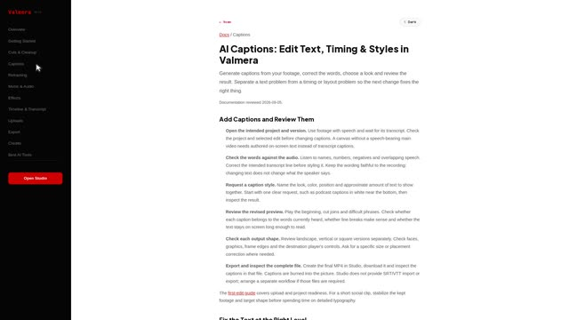

# Embed a product demo as an MP4 or GIF

Use a click-to-play MP4 when your website can display video. Deliver a static poster that shows the result, with text that explains the action. Use a GIF for a short, silent preview when the destination accepts only animated images. Link it to the full demo if viewers need to pause, read small interface text, or hear narration.

## Play two versions of the same website capture

We took six seconds from [Valmera’s real website capture](https://valmera.io/tools/record-website-demo#events), where a pointer opens the Captions documentation. Each encoding uses the same 72 source frames at 640 × 360. The conversion ran locally with FFmpeg.

[](examples/product-demo-embed/demo.mp4)

| File | Bytes | Use it when |
| --- | ---: | --- |
| [Six-second MP4](examples/product-demo-embed/demo.mp4) | 51,926 | The destination has a video player with controls. |
| [Six-second looping GIF](examples/product-demo-embed/demo.gif) | 167,566 | The destination requires an image and the frames make sense in silence. |
| [Static JPEG poster](examples/product-demo-embed/demo-poster.jpg) | 20,758 | The viewer should choose whether to start motion. It shows the page that opened. |

The MP4 saved about 69% of the GIF’s bytes in this sample. Its separate poster and MP4 together are about 57% smaller than the GIF. These are file sizes, independent of request latency, caching and player behavior. At this size you can read the new page title, but the body text is small. Use a tighter capture or a deliberate zoom if the viewer needs to read instructions.

## Make the embed from your approved edit

For a silent preview, re-encode the opening six seconds of your approved export. Use a different start point or duration if the result appears later. Keep the full approved MP4 for people who need the entire workflow.

```sh
ffmpeg -i approved.mp4 -t 6 -an -vf 'fps=12,scale=640:-2:flags=lanczos' \
  -c:v libx264 -crf 22 -pix_fmt yuv420p -movflags +faststart demo.mp4

ffmpeg -i approved.mp4 \
  -filter_complex 'trim=duration=6,fps=12,scale=640:-2:flags=lanczos,split[a][b];[a]palettegen=stats_mode=diff[p];[b][p]paletteuse=dither=bayer:bayer_scale=4[out]' \
  -map '[out]' -loop 0 demo.gif

ffmpeg -ss 4.75 -i demo.mp4 -frames:v 1 -q:v 4 demo-poster.jpg
```

The `-an` flag strips audio for this preview. If the full demo depends on narration, keep the audio in the main MP4 and provide matching captions or a transcript. A capture from a public URL in Valmera is silent. Supply your own recording if you want narration in the edit.

```html
<video controls playsinline preload="none" poster="demo-poster.jpg"
       width="640" height="360" aria-label="Open the Captions guide in Valmera">
  <source src="demo.mp4" type="video/mp4">
  <a href="demo.mp4">Download the six-second product demo</a>
</video>
<p>In the sidebar, choose Captions. The AI Captions guide opens.</p>
```

Review the published embed at the smallest size customers use. Check that the pointer reaches the control, the result appears before the video ends, and the poster works as a static preview. Letting the reader start playback also gives them control over motion. See [web.dev’s video performance guidance](https://web.dev/learn/performance/video-performance) and [Google’s reduced-motion guidance](https://web.dev/articles/prefers-reduced-motion).

[Record your own website demo in Valmera](https://valmera.io/tools/record-website-demo?utm_source=github&utm_medium=documentation&utm_campaign=website_demo_embed). If you need recurring edits for multiple product or help pages, [contact Valmera Enterprise](https://valmera.io/subscribe?inquiry=product-demo-video-editing-service&utm_source=github&utm_medium=documentation&utm_campaign=website_demo_embed#enterprise). Include your monthly video count, one example flow, and the places each version will appear.
