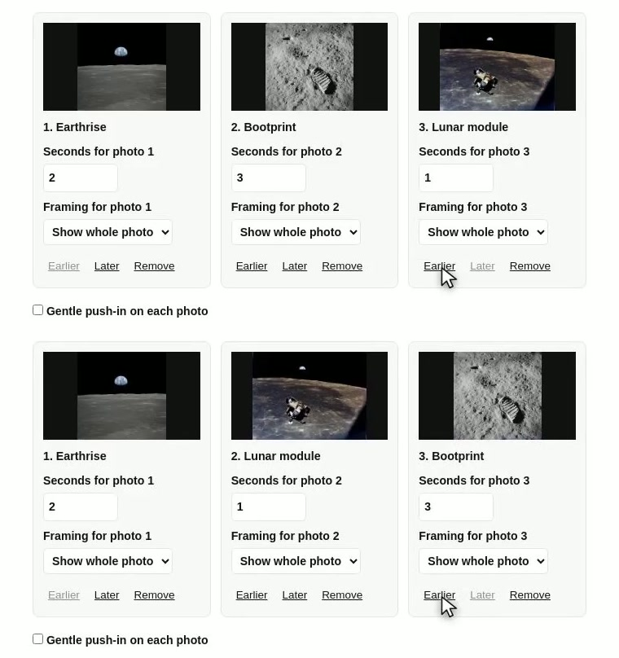
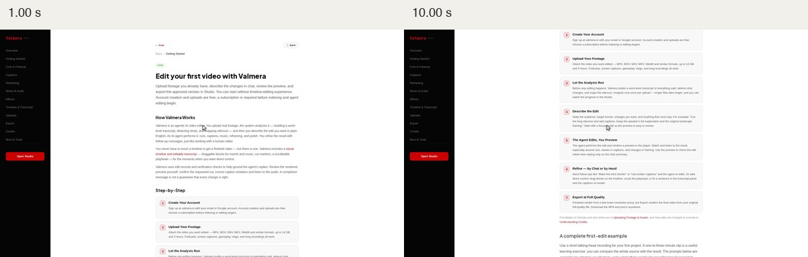

# Make a website demo video with an AI assistant

Turn a public product page into a short walkthrough with Valmera, or edit a screen recording you already made. Give the assistant a viewer, one task and a visible result. Then review the recorded actions and the finished video before sharing it.

**[Start from your website URL](https://valmera.io/tools/record-website-demo?utm_source=valmera_mcp_docs&utm_medium=repository&utm_campaign=mcp_website_demo#start-demo)** · [Choose a ready-to-edit brief](https://valmera.io/tools/record-website-demo?utm_source=valmera_mcp_docs&utm_medium=repository&utm_campaign=mcp_website_demo#demo-briefs) · [Watch a finished example](https://valmera.io/examples/product-demo)

## What can I try before signing up?

Play the finished demo below, inspect its frames or prepare a walkthrough brief for free. To make a fresh website recording in Studio, choose a plan that includes **Record website demo**. Studio offers the feature on Pro and Max. A trial or new Plus account can see an upgrade card before any recording starts. If you edit through a connected assistant, check your account’s MCP editing access. The assistant provider bills separately. [Compare current plans](https://valmera.io/subscribe).

## Record a button click and prove it changed the page

Imagine reviewing a demo on mute. A cursor reaches **Earlier**, but did the photo actually move? The Valmera team recorded its public slideshow builder using the included NASA Apollo 11 photos. The third photo moves to second place while the URL stays the same.

**[Download the finished 1080p MP4 (2.4 MB)](https://raw.githubusercontent.com/ABO3SKRALMASAOODI/valmera-mcp/main/docs/examples/website-photo-reorder/reorder.mp4)** · [Open the two frames at full size](examples/website-photo-reorder/frames.jpg) · [Get the capture steps](examples/website-photo-reorder/recording.json)

| Time in the exported MP4 | What to look for |
| --- | --- |
| 3.00 s | The strip reads **1. Earthrise, 2. Bootprint, 3. Lunar module**. Bootprint has three seconds assigned to it. |
| 4.30 s | The recorder logs a click on **Earlier** under the third photo. Listen for the single click or watch the pointer. |
| 5.40 s | **2. Lunar module** now has one second and **3. Bootprint** has three. The durations moved with their photos. Earthrise stayed first. |
| 8.00 s | The camera pushes closer so the new order is readable. The 9.4-second demonstration is followed by Valmera’s five-second end card. |



**Try the same brief in a connected assistant**

> Record the photo sequence on https://valmera.io/tools/ai-slideshow-maker#photo-sequence in landscape. Show all three cards, then move Lunar module ahead of Bootprint. Keep the new order on screen and move closer so I can read the labels. Play the preview before exporting.

For a repeatable take, give the assistant the capture steps above and the ID of your own project. The page has several controls labeled **Earlier**. The recording targets the third photo by its accessible button name, **Move photo 3 earlier**. After recording, place the clip on the timeline with `showcase_demo`. Review the order in the preview, then export that reviewed edit version. Starting another capture creates another recording.

To adapt the test to your site, write down two visible values before recording. For a calculator, use the input and the displayed total. For a settings page, use the old and new setting. A recorded click identifies where to look. The changed value in the downloaded MP4 tells you whether the demo delivered the result.

Use the same recording to [check whether a vertical cut preserves the visible result](VERTICAL-PRODUCT-DEMO.md).

If the recorded action creates a downloadable file, [verify the confirmation and the downloaded CSV](RECORD-A-PRODUCT-DEMO-THAT-EXPORTS-CSV.md) with an offline demo workspace.

## Install the website walkthrough skill

In a project using Node.js 22.20 or later, run the command for your client. Each installs the same [MIT-licensed skill file](https://github.com/ABO3SKRALMASAOODI/valmera-mcp/blob/v1.0.1/skills/website-demo-video/SKILL.md) from release `v1.0.1`. Choose a project-local install when prompted, then refresh your agent session.

**Claude Code**

```sh
npx skills@1.7.6 add ABO3SKRALMASAOODI/valmera-mcp@v1.0.1 --skill website-demo-video -a claude-code
```

**Codex**

```sh
npx skills@1.7.6 add ABO3SKRALMASAOODI/valmera-mcp@v1.0.1 --skill website-demo-video -a codex
```

The [install guide](https://valmera.io/mcp/skills#install-website-demo-video) also includes the Cursor command. You can try the review step with the public recordings before connecting an account. Download the [first capture](https://valmera.io/examples/website-capture/first-attempt.mp4) and [third capture](https://valmera.io/examples/website-capture/public-docs-walkthrough.mp4) into your project. In an agent that can inspect local video or extract frames, try this request:

> Use website-demo-video to review the two MP4s in this project. The brief was to open Captions from the Getting Started sidebar. For each recording, report the heading visible after the attempted click and the time of the frame you inspected. Which recording would you keep? Use the supplied footage only.

Check the answer against the [paired frames and recorded click times](#check-whether-the-recorded-click-reached-its-destination). If your client cannot inspect video, open the paired frames there. For a new recording on your own site, connect Valmera using the steps below.

## Choose the starting material

| Starting material | Use this route | Include in the brief |
| --- | --- | --- |
| A public landing page, feature page or documentation flow | Record from its public URL | The exact page, visible controls, order of actions and intended result |
| A signed-in dashboard or desktop application | Upload your own screen recording made with demonstration data | The source project, steps to keep, waits to remove and narration |
| An existing launch video needing a shorter cut | Open that project and revise its current version | Destination, target length and the explanation that must survive |

A URL recording does not inherit the login session in your own browser. For an authenticated workflow, start with your own recording rather than supplying a password to a recording step.

You can start directly in [Valmera's website-demo workspace](https://valmera.io/tools/record-website-demo?utm_source=valmera_mcp_docs&utm_medium=repository&utm_campaign=mcp_website_demo#start-demo). Choose **20-second vertical showcase** for a portrait tour, or **Landscape product walkthrough** to demonstrate a task. For a walkthrough, enter the public URL and describe the result a first-time viewer should be able to reproduce. Select **Preview walkthrough brief** to read the proposed request. Copy it into a connected assistant or select **Open walkthrough brief in Studio** to take the draft through sign-in.

For example, start with `https://valmera.io/docs/getting-started` and enter “Open Captions in the sidebar, then show the heading that confirms the Captions guide loaded.” The brief carries both the URL and the requested action. Review it in Studio, then send it when ready. Preparing and copying the brief are free. The recording runs through your editing plan. You can compare the resulting navigation with the [public source footage and click record](https://valmera.io/examples/website-capture).

For direct editing from an assistant, follow the [client setup guide](https://valmera.io/mcp/setup) and authorize `https://valmera.io/mcp/server`. Refresh the available tools and select the intended project. An assistant without that connection can help write the brief; bring the brief to Valmera to execute it.

## Which demo maker should operate the browser?

If you need an agent to follow a public path and return footage you can revise by chat, start with the [Valmera capture and finished MP4](https://valmera.io/examples/product-demo). Demosmith describes an agent-operated workflow that also returns a clickable demo and written instructions. If someone on your team will perform each action and the viewer needs to explore hotspots, Supademo documents a guided capture and Arcade offers an interactive recorder. Arcade also offers a separate AI video workflow. The [product demo maker comparison](https://valmera.io/use-cases/saas-demos#interactive) links the providers’ capture and delivery documentation.

For a demo you need to re-record after each release, [compare saved recipes and run one repeatable click test](RECORD-A-REPEATABLE-PRODUCT-DEMO.md).

For a person-operated browser recorder that adds zooms on clicks, [compare Cursorful and Valmera on the same website walkthrough](CURSORFUL-VS-VALMERA-WEBSITE-WALKTHROUGHS.md). The test checks who operates the browser and whether the downloaded MP4 shows the requested destination.

### Compare coding-agent recorders by what you can take away

| What you need after the click | Option to evaluate | What to open during the trial |
| --- | --- | --- |
| A capture you can revise in a hosted editing project | Valmera | Compare the [source capture and action log](https://valmera.io/examples/website-capture), then inspect the [separate edited demo](https://valmera.io/examples/product-demo). For your own trial, request a longer hold on the result and play the revised preview. |
| A repeatable local filming recipe for a product that changes | DemoBites Agentic Recorder | Its [recorder guide](https://demobites.com/docs/bites/agentic-recorder) describes a local browser recording and a saved recipe. Change a label in a test app, retake the tour, and check that the new label appears. |
| A shareable recording another agent can inspect | Clipy | Use the [MCP recorder](https://clipy.online/mcp) for capture and its [reader skill](https://clipy.online/docs/skill) for the handoff. Give the resulting link to a second reviewer and check whether they can locate the result. |
| Local MP4s and a manifest for scripted browser scenarios | ItachiDevv’s Claude screen recorder | Its [repository](https://github.com/ItachiDevv/claude-screen-recorder) documents JSON actions and the output folder. Open the MP4 and match the visible result to the scenario you supplied. |

The alternative workflows above come from their maintainers’ documentation. The paired frame checks below apply to Valmera’s published capture.

For a short trial, ask each tool to show monthly pricing, switch to annual billing, and hold on the new amount. Use a public pricing page where both states are visible. In a creator-operated recorder, perform the same steps yourself. Record who operated the page and the times when the control moved and the new amount appeared. Open the downloaded MP4. Can you read the amount and billing period, and can you locate the action that changed them? If your buyer needs a branching tour, also open the shared interactive link and take a second path.

## Plan one visible outcome

A useful short demo answers one question: “How do I accomplish this task?” Use this four-part sequence, filling in the actual controls from your website:

| Moment | What the viewer sees | What to check |
| --- | --- | --- |
| Establish the task | The starting page and a short benefit or task label | The label describes what the demo actually shows |
| Show the action | A visible pointer reaches and activates the relevant control | The intended control is selected and the page responds |
| Explain the result | The changed page, setting or output remains readable | The change proves the promised outcome |
| Close with a next step | A concise invitation appropriate to the destination | The final frame stays long enough to read |

Do not prescribe every feature on the site. If the task needs more explanation than the target length allows, preserve the necessary steps and shorten the promise.

## Three briefs to adapt

Replace bracketed details with your own material before sending.

### A 30-second product walkthrough

> Make a landscape demo of [public URL] for [audience]. Show how to [one task], ending on [visible result]. Propose three visible actions using the actual controls on the page before recording. Keep the interface readable, remove long waits, and add short step labels. Use a restrained zoom only when a control needs emphasis. Show me the recorded result and an edited preview before export.

### A vertical feature launch

> Make a 20-second vertical demo of [public feature URL]. Open with [benefit], demonstrate [one feature], and finish with [next step]. Check whether the page works in a portrait layout. Keep the important control and its result visible together where possible. If the desktop layout becomes unreadable, propose a different composition. Keep music below any supplied narration and show me the final crop for review.

### Onboarding from an uploaded dashboard recording

> Use [project or uploaded recording] to explain how to [task]. Keep [required actions] in order and finish on [result screen]. Remove setup time and long waits, add a short label for each step, and align the sequence with [supplied narration]. Keep the final result visible long enough to understand it. Use demonstration data and flag visible account details or notifications for review. Show me a preview before exporting.

The [saved briefs on the website](https://valmera.io/tools/record-website-demo?utm_source=valmera_mcp_docs&utm_medium=repository&utm_campaign=mcp_website_demo#demo-briefs) carry into sign-in as drafts. Supply your URL or recording and review the brief before submitting it.

## From the brief to an exported video

1. **Choose the project and plan.** Agree on the source, orientation, actions and result. Use the current tool schema exposed by your authorized connection.
2. **Capture or open the recording.** For a public page, the website recording tools can produce the capture and an event track. For uploaded footage, inspect the source before choosing cuts or zooms.
3. **Inspect the actions.** Check for skipped steps and watch whether each interaction reaches the intended result. A completed recording job can still contain a missed click.
4. **Edit the story.** Tighten waits, make important controls readable, add concise labels and place supplied narration or music. Keep the explanation aligned with what is visible.
5. **Review a rendered preview.** Wait for the render to finish. Watch the result with sound and inspect each important action, page change and final frame.
6. **Export the reviewed version.** Follow the current export workflow, wait for completion, obtain the final download and open the file. A job identifier alone is not the deliverable.

The bundled [website-demo skill](../skills/website-demo-video/SKILL.md) describes the tool-oriented sequence. The [general MCP workflow](WORKFLOW.md) covers projects, source inspection, preview and export.

## What an actual capture shows

The [public documentation capture](https://valmera.io/examples/website-capture) was recorded on September 9, 2026. Its [request and event evidence](https://valmera.io/examples/website-capture/evidence.json) describes a 1920 × 1080, 30 fps, approximately 10.8-second silent capture: wait, click the Captions link in the visible sidebar, scroll and hold.

The first two requests produced recordings but reported no completed click. The third used a selector scoped to the visible sidebar and reported one click at 3.57 seconds and one scroll at 5.72 seconds. Sampled frames showed the Captions page after navigation. The lesson is practical: inspect both the event report and the video before adding polish to a captured sequence.

That is a dated example from one public site, not a guarantee that an arbitrary page or selector will work. Inspect the current page and current tool schema for a new recording. The raw capture is separate from the [finished product-demo example](https://valmera.io/examples/product-demo), which shows an edited result.

## Check whether the recorded click reached its destination

The task in this example was to open **Captions** from the Getting Started guide, then scroll the destination. Scrolling alone can make an unsuccessful capture look convincing. Here is how to tell what happened from the saved files.

| Attempt | Click target in the request | What the recorder reported | What you can inspect |
| --- | --- | --- | --- |
| 1 | The visible label `Captions` | Zero clicks, two scrolls | [13-second capture](https://valmera.io/examples/website-capture/first-attempt.mp4). At 10 seconds the Getting Started instructions are still on screen. |
| 2 | `a[href='/docs/captions']` | Zero clicks, one scroll | The [request and event record](https://valmera.io/examples/website-capture/evidence.json) covers this run. Only the first and third recordings were checked frame by frame for file readability. |
| 3 | `.docs-sidebar a[href='/docs/captions']` | One click at 3.57 seconds, then one scroll at 5.72 seconds | [10.83-second capture](https://valmera.io/examples/website-capture/public-docs-walkthrough.mp4). At 4 seconds the page heading reads “AI Captions: Edit Text, Timing & Styles in Valmera.” |

**First attempt.** The second frame shows the next section of the original guide.



**Third attempt.** At 3.50 seconds the pointer is near the sidebar link. By 4.00 seconds the destination heading is visible.


To reproduce the second comparison, download the third capture and run these commands in its folder with FFmpeg installed. Open both PNG files and compare the page heading.

```sh
ffmpeg -v error -ss 3.50 -i public-docs-walkthrough.mp4 -frames:v 1 before-click.png
ffmpeg -v error -ss 4.00 -i public-docs-walkthrough.mp4 -frames:v 1 after-click.png
```

### Check how long the result stays visible

The [result checker](evaluation/verify_website_demo_result.py) compares a crop of a trusted screenshot with every frame in a time window. It can distinguish a visible result from a recording that scrolls without completing the intended click. The two public captures above provide a pass and a failure to test the check before applying it to your own footage.

From the repository root, with Python and OpenCV (`opencv-python`) installed:

```sh
curl -fL https://valmera.io/examples/website-capture/public-docs-walkthrough.mp4 -o completed.mp4
curl -fL https://valmera.io/examples/website-capture/first-attempt.mp4 -o skipped.mp4

python3 docs/evaluation/verify_website_demo_result.py completed.mp4 \
  docs/examples/website-demo-result-check/completed-4.0.jpg \
  --crop 367 73 698 112 --window 3.5 5.5 --hold 1

python3 docs/evaluation/verify_website_demo_result.py skipped.mp4 \
  docs/examples/website-demo-result-check/completed-4.0.jpg \
  --crop 367 73 698 112 --window 3.5 5.5 --hold 1
```

The crop isolates the Captions heading. The successful 30 fps recording passes with a 1.833-second match starting at 3.667 seconds. The skipped recording exits with status 1 and zero matching seconds. A malformed input or unreadable window exits with status 2.

For a new demo, capture a trusted screenshot of the result manually, crop to a distinctive label or value, and choose the minimum reading time for your audience. Use a constant-frame-rate MP4 and a reference that matches the export layout. This checks visual similarity at the chosen scale. Re-crop after changing the zoom, locale, theme or layout, and watch the final passage to judge readability and context. [Try Valmera’s website-demo workflow](https://valmera.io/tools/record-website-demo?utm_source=valmera_mcp_docs&utm_medium=repository&utm_campaign=verify_website_demo_result).

For your own demo, write down the text or state that should appear after the action. If two controls share the same label, identify the visible navigation region and give the recorder a target within it. Review that short passage before asking for zooms or narration. On a signed-in dashboard, supply your own screen recording with demonstration data. Valmera’s public URL recorder starts in a separate browser session.

## Check that every deliverable shows the same outcome

Use the [demo delivery review sheet](examples/website-demo-delivery-check.csv). It includes two completed rows from the public recordings above and blank rows for a finished MP4, clickable walkthrough and written guide.

First write down the exact result that proves the action worked. Review each output from its own starting state. For the MP4, log the time at which a viewer can read the changed screen. For a clickable walkthrough, take the documented path in an incognito tab and check the final state. For a guide, follow the steps in a demo account without watching the video. Write down where a viewer gets stuck even if the other outputs pass.

When a product change affects one step, update every version a customer might use. Have a reviewer repeat the task from each published link. Check each version again when a page label, permission or menu location changes.

## Review and revise precisely

- **Actions:** Did each intended click, scroll or page change happen in order?
- **Readability:** Can a new viewer identify the controls and read the result at the intended viewing size?
- **Timing:** Are long waits removed while required steps and the result remain understandable?
- **Sound and labels:** Do narration and labels describe the action currently on screen? Can the viewer hear the voice clearly?
- **Release:** Does the downloaded version contain the reviewed edits, with appropriate demonstration data and a readable ending?

For a targeted revision, identify the current preview and the problem:

> In the current preview, the result screen after [action] disappears before I can read it. Hold that screen longer and reduce the zoom enough to show [important control]. Keep the other cuts and labels unchanged. Render the revised preview.

If you reference a time, specify whether it belongs to the original recording or the edited preview. Cuts and speed changes can move the same moment to a different time.

[Start your website demo](https://valmera.io/tools/record-website-demo?utm_source=valmera_mcp_docs&utm_medium=repository&utm_campaign=mcp_website_demo#start-demo) · [More creator workflows](CREATOR-WORKFLOWS.md) · [Connection troubleshooting](CONNECTION-TROUBLESHOOTING.md)
