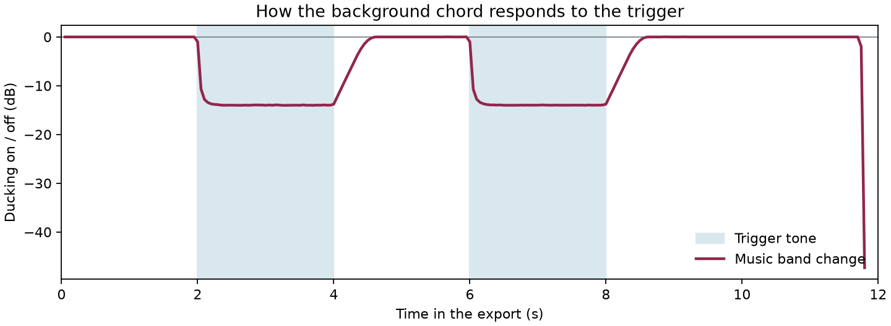

# How to check audio ducking in a video edit

Play the [fixed-gain mix](https://valmera.io/examples/music-ducking/without-ducking.m4a), then the [ducked mix](https://valmera.io/examples/music-ducking/with-ducking.m4a) at the same volume. Listen for the low chord at second 3, while the higher tone is playing, and again at second 5, during the gap. Both clips last 12 seconds.

[Open the listening notebook in Google Colab](https://colab.research.google.com/github/ABO3SKRALMASAOODI/valmera-mcp/blob/main/docs/examples/audio-ducking/listen-and-measure.ipynb). Choose **Runtime → Run all** to hear the two files, draw the curve, and measure the change. The last cell also accepts two exports of the same exercise from your own editor.

## What changed in the export?

The music consists of three notes at 220, 330 and 440 Hz. A louder 880 Hz tone plays from seconds 2–4 and 6–8 on a separate track. In the second mix that track controls a compressor on the music. Because the two occupy separate frequency bands, the notebook can measure what happened to the music even while the trigger is sounding.

| Where to listen | Time in each file | Change in music level |
| --- | --- | ---: |
| Before either tone | 0.8–1.6 s | 0.00 dB |
| During the first tone | 3.0–3.8 s | −14.00 dB |
| In the gap | 5.0–5.8 s | 0.00 dB |
| During the second tone | 7.0–7.8 s | −13.99 dB |
| After the last tone | 10.0–10.8 s | 0.00 dB |

These are relative measurements of the 180–500 Hz band in the two decoded exports. The reference comes from a local Valmera renderer run using synthetic tones. Speech intelligibility needs a separate listening test with a real voice. [Original renderer settings and checksums](https://valmera.io/examples/music-ducking/evidence.json)

## Run the comparison in another editor

1. Put the [source video with the two trigger tones](https://valmera.io/examples/music-ducking/source-with-tones.mp4) and the [background chord](https://valmera.io/examples/music-ducking/music-bed.wav) on separate tracks. Align both at the start of the timeline.
2. Export a 12-second reference mix. Export it again with automatic ducking enabled on the music and the video's audio as the trigger. Preserve track gain, timing, master level and format across both exports.
3. Enter the two file paths in the notebook's final cell. If the music also drops in the opening, check for a gain or alignment change. If it stays quiet throughout the gap, compare the release settings.
4. Try the chosen settings on a spoken passage. Listen to the first consonant, the final word and the pause between phrases. The measured 14 dB drop describes this fixture. Pick the reduction for your recording by ear.

For an edit of your own, use the [Valmera music guide](https://valmera.io/tools/add-music-to-video?utm_source=github&utm_medium=example&utm_campaign=audio_ducking). Upload the music you have permission to use and describe where it should sit beneath the voice.
