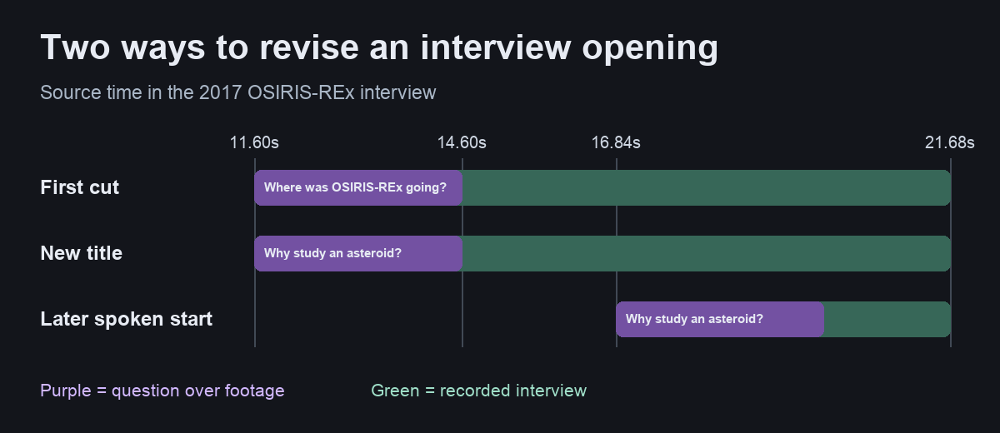

# Change the opening of a captioned interview clip

After the first preview, “change the hook” can mean rewriting the question viewers read or starting the recording at a later sentence. Try both on the same answer. In this September 2017 interview, NASA Goddard astrophysicist Michelle Thaller introduces OSIRIS-REx and explains why an asteroid interests scientists. Listen for the difference between introducing the mission and going straight to the reason. [Original interview, captions and credits](https://svs.gsfc.nasa.gov/12713/)

| Version | First thing viewers read | Recording used | Picture duration at 25 fps |
| --- | --- | --- | --- |
| Mission | Where was OSIRIS-REx going? | 11.60–21.68 s | 10.08 s, 252 frames |
| Asteroid | Why study an asteroid? | 11.60–21.68 s | 10.08 s, 252 frames |
| Shorter | Why study an asteroid? | 16.84–21.68 s | 4.84 s, 121 frames |



**Play the two source passages.** The longer excerpt names the mission and its destination. The shorter one begins just before “And the reason asteroids are so exciting.” That opening works for a viewer who can already see the question. If your audience needs to know which mission the speaker means, keep the introduction. [Longer passage on NASA’s server](https://svs.gsfc.nasa.gov/vis/a010000/a012700/a012713/Thaller_OSIRIS-REx_EGA_Interview.mp4#t=11.6,21.68) · [Shorter passage](https://svs.gsfc.nasa.gov/vis/a010000/a012700/a012713/Thaller_OSIRIS-REx_EGA_Interview.mp4#t=16.84,21.68)

## Try the spoken cut in the free browser editor

1. Download the original Thaller MP4 from NASA. In Valmera’s free trim tool, choose your video and select **Keep only this passage**. Enter **11.60** and **21.68** seconds. Create and download the MP4. [Open the editor](https://valmera.io/ai-video-editor?utm_source=valmera_mcp_docs&utm_medium=repository&utm_campaign=interview_opening#free-trim)
2. Keep the same source loaded. Change the start to **16.84** seconds and keep the end at **21.68**. Download the second MP4 under a different name.
3. Import the matching captions at the start of each sequence. The third cue in the long cut begins at **5.30 s**. In the short cut those words come in at **0.06 s**. If the short clip starts with captions introducing the mission, it has the first cut’s subtitle file. [Long-cut SRT](answer.srt) · [Short-cut SRT](shorter-opening.srt)

For our recorded browser test, we first made a 640 × 360, 25 fps practice file starting exactly eight seconds into the original. On that file the two ranges were **3.60–13.68** and **8.84–13.68**. Valmera delivered 252 and 121 picture frames. The MP4 containers reported **10.15 s** and **4.91 s**, respectively. Compare picture boundaries using frame counts. The downloaded files include AAC audio that extends beyond the last picture.

## Render all three portrait versions

Save the files in this folder together. Download the source MP4 from NASA. Run these commands with Python 3 and an FFmpeg build that includes libx264, drawtext and libass. The recipe looks for Arial. A system font substitution can change the appearance of the letters.

```sh
python3 render.py Thaller_OSIRIS-REx_EGA_Interview.mp4 renders
python3 compare.py renders/mission.mp4 renders/asteroid.mp4
```

The recipe places the landscape picture inside a 540 × 960 canvas so the camera’s cut to spacecraft footage stays visible. The question sits above the image for the first three seconds. The speaker’s captions sit below it. These are locally reproducible reference renders produced with FFmpeg. The two landscape trims described above were exported separately from Valmera’s live browser tool. The science footage stays on NASA’s server until you download it.

In our paired portrait renders, only frames **0–74** changed between the two question versions. The remaining **177 frames** matched exactly, and both decoded soundtracks had the same SHA-256. The frame hash check is suitable for this controlled encode. Independent exports from another editor can differ in compression. To review those, compare the retained line, its first caption, the picture at the cut and the end of the answer. [Render script](render.py) · [Comparison script](compare.py)

## Ask an AI editor for one revision at a time

For a title revision, give the assistant both the new words and their duration.

> On the current preview, replace the opening question with “Why study an asteroid?” for the first three seconds. Keep the picture edit, dialogue, framing and spoken captions. Show me the revised preview.

For a spoken revision, identify the first retained words and the original source time.

> Start the clip at source 16.84 seconds, just before “And the reason asteroids are so exciting.” Keep the answer through 21.68 seconds. Move the surviving captions with the speech and keep the question visible above the picture. Export a second version so I can compare the openings.

Adapt the source times, question and caption files before using the recipe on your own recording. For a client interview, check that a viewer entering at the later sentence still knows what the speaker is referring to. [Valmera interview workflow](https://valmera.io/use-cases/interviews?utm_source=valmera_mcp_docs&utm_medium=repository&utm_campaign=interview_opening) · [Connect an AI assistant](https://valmera.io/mcp/setup)
