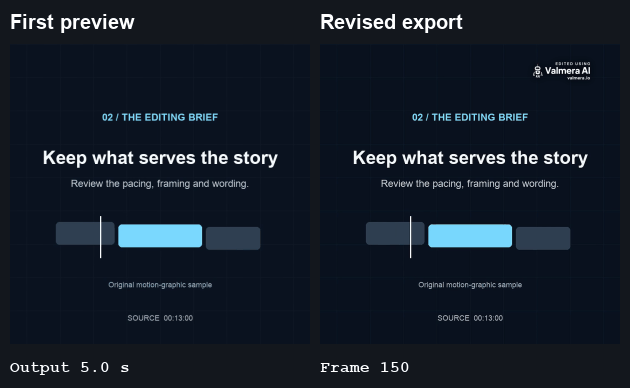

# Can an AI video editor shorten just one shot?

Try this on the same 25 seconds of footage in any editor. Make a three-shot cut, watch the first preview, then ask for one change. At six seconds the revised cut should already be on the closing shot. The first preview should still be in the middle shot.

## Give your editor two requests

Download the [original footage](https://valmera.io/examples/trim-and-reframe/original-source.mp4). It has a clock burned into the picture, so you can tell which source frame you are watching. Give the editor the file and the first request. Save the preview before asking for the revision.

> Make a rough cut from these three parts of my source, in this order. Keep seconds 3–7, 12–16 and 19–23. Show me the preview.

> Shorten the middle shot by two seconds at its tail. Keep the opening and closing shots intact, move the closing shot up to meet the cut, and export the revised MP4.

To try the timing yourself without an account, open the [browser timeline builder](https://valmera.io/blog/ai-rough-cut-to-editable-timeline?utm_source=valmera_mcp_docs&utm_medium=repository&utm_campaign=revision_kit#make-timeline). Export the 12-second preset, switch to **Shorter middle shot · 10 seconds**, and export again. You can also download the editable Shotcut timeline. For the conversational version, use the [Valmera connection guide](https://valmera.io/mcp/setup) and a project with editing access.

## Check the edit in the delivered file

| Where to pause at 30 fps | Source picture in the first cut | Source picture after the revision |
| --- | --- | --- |
| Output frame 179, the last frame before 6 seconds | Frame 419, immediately before source second 14 | Same frame 419 |
| Output frame 180, exactly 6 seconds | Frame 420, start of source second 14 | Frame 570, start of source second 19 |
| Output frame 240, exactly 8 seconds | Frame 570, start of the closing shot | Frame 630, two seconds into the closing shot |

If frame 180 still shows the middle shot, check which edit version was exported. If the picture goes black there, check whether the closing clip moved forward when you trimmed the middle. Play the tail too. In Valmera’s recorded run the program lasts 10 seconds and the delivered file lasts 15, including a five-second branded ending. The [recorded tool arguments and output frames](../../MCP-RECORDED-EDIT.md) show the source interval removed by `cut_range`.

## Compare or reproduce the results

- **Watch the files.** Compare Valmera’s [first preview](https://valmera.io/examples/agent-revision/first-preview.mp4#t=6) and [revised final](https://valmera.io/examples/agent-revision/revised-final.mp4#t=6), or inspect [MakeMyClip’s two renders and timeline calls](makemyclip/README.md). Both editors made the requested timing change on this silent sample.
- **Test your own export.** [Open the notebook in Colab](https://colab.research.google.com/github/ABO3SKRALMASAOODI/valmera-mcp/blob/main/docs/examples/video-edit-revision/check-revision.ipynb). Use the same source and shot order. The notebook compares 120 frames where the two instructions differ and displays the pictures around the join. A different crop, overlay or grade can change the pixel score, so inspect the displayed source clocks too.
- **Work offline.** [Download the test kit](https://raw.githubusercontent.com/ABO3SKRALMASAOODI/valmera-mcp/main/docs/examples/video-edit-revision/revision-test.zip), extract it, and run `python3 score.py` in that folder with FFmpeg on your path. It includes the source, all four rendered files and an executed notebook.

Valmera published this exercise to test revision timing. Evaluating story choices or dialogue requires different footage.
